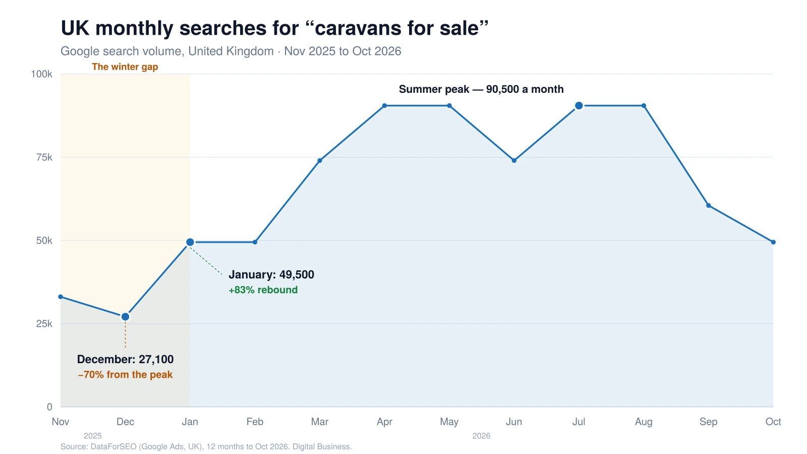

Searches for caravans for sale in the UK fall around 70% between the summer peak and December. Then they jump more than 80% in January.

That has happened every year for the last five. It isn't a slump. It's a calendar.

Most dealers read the drop as a reason to go quiet. The smart ones read the return date as a deadline.

Because the pages that rank in January are built in November, not March.

This post shows you what to do in the gap. Let's begin.

## The short version

Searches for caravans for sale in the UK fall around 70% from the summer peak to December, then rebound more than 80% in January. The same cycle repeats every year, so the quiet months are the cheapest time to prepare for the return.

Three steps to do it:

1. Build and fix your key pages now, while it's quiet and cheap to do.
2. Be live and ranking in early January, not scrambling in March.
3. Keep a trimmed, targeted paid budget running through the quiet, not switched off.

## What actually happens to caravan demand between October and January

Here is the shape of it. Searches for caravans for sale in the UK sit at roughly 90,500 a month at the summer peak. By October they are down to 49,500. By November, 33,100. By December, 27,100.

Then January arrives and they jump back to 49,500.

Said plainly, so there is no doubt about the number: searches for caravans for sale fall roughly 70% from the summer peak to December, then rebound more than 80% in January.

This is not a caravan quirk. The whole category moves together:

- **Static caravans for sale:** 40,500 at peak, down to 18,100 in December. A 55% drop.
- **Touring caravans for sale:** 18,100 down to 3,600. An 80% drop.
- **Used caravans for sale:** 6,600 down to 1,600. A 76% drop, and a 125% jump back by January.

Notice where the fall is sharpest. It is not the shiny new stock. It is the used and touring market.

That matters. That is where a lot of dealers make their margin and turn their stock over fastest. The deepest quiet sits on the pages that earn you the most.

## This isn't a slump. It's the same cycle every year

A slump sounds like bad luck. Something that happened to the market this year, out of your hands.

This isn't that. Pull five years of Google Trends for caravans for sale and the same shape is drawn again and again. A summer peak. A fall through autumn. A trough in late November and December. A climb back from January to a second peak in spring.

2021, 2022, 2023, 2024, 2025. The same curve, every time.

That is the part worth sitting with. You cannot plan around a surprise. You can plan around a calendar you have watched run five times.

The demand doesn't disappear in winter. It moves. And it moves to the same place at the same time every year.

Two honest caveats. The exact drop shifts a little year to year, and 2024 ran lower than the years either side of it. Your own patch can peak earlier or rebound sooner than the national line, which is the last thing we'll come to.

But the pattern itself is about as dependable as anything in this trade gets.

## Where the demand goes, and who's still searching in December

Here is the trap in that 70% figure. It reads like permission to switch everything off. It isn't.

27,100 searches a month for caravans for sale in the quietest month of the year is not nothing. It is a lot of people still actively looking.

And the people searching in the cold tend to be the serious ones. They are researching, comparing finance, weighing a part-exchange, lining up a purchase for spring. The casual summer browser has gone. The buyer is still here.

Look at "caravan dealers" as a search. It drops about 70% too, from 2,900 a month down to 880 in December.

But think about who those 880 are. They are people typing "caravan dealers" into Google in the middle of winter, looking for someone to buy from, while half the trade has gone quiet.

Smaller audience. Warmer audience. Fewer rivals in front of them.

## What smart dealers do in the gap

So the demand drops, it doesn't vanish, and it comes back on a date you can predict. The question is what you do with the eight quiet weeks in between. Here are five moves worth making, this week.

### Do the slow SEO work now, while it's quiet
New pages and rewrites take weeks to index and earn their rankings. Google does not reward them overnight.

Build them in November and they are mature and ranking when demand returns in January. Build them in March and you are invisible for the first wave of buyers.

The quiet period is production time, not downtime. Your static caravan pages are a good place to start, where search volume is high and the competition for rankings is surprisingly thin. *[Internal link, once live: why your used stock pages don't rank.]*

### Be live for January, not the March scramble
Demand jumps more than 80% in January. Yet a lot of the trade waits until spring to spend and publish.

That gap is the opening. Being ready in early January means catching buyers while your competitors are still asleep.

### Match what winter buyers are actually doing
Winter searchers research more than they buy on the day. They look at finance, part-exchange, storage, best time to buy, spec comparisons.

Pages that answer those questions catch the buyer now and convert them in spring. Keep any finance content to plain marketing. No advice, no claims you can't stand behind.

### Keep catching the events that buck the trend
The autumn and February shows and the new-model launches create their own spikes against the seasonal floor.

Don't let a quiet month mean switching off the pages that catch show and launch demand. *[Internal links, once live: catching show visitors after the show; 2027 model launches.]*

### Don't cut your paid spend to zero
Fewer rivals bidding in the quiet months can mean cheaper clicks for the high-intent searches that are left. The core term holds its competition and roughly its cost-per-click all year round, so the auction never really empties out.

Trim and target rather than go dark. Measure cost per enquiry, not just clicks.

## Where to point the quiet months

Everything above is the national picture. Your own patch is not the national picture.

Knowing the drop is coming is one thing. Knowing where to aim is what turns it into an advantage.

So start in one place. Find out when your own area, say the 50 miles around your forecourt, actually stops and starts searching for caravans for sale. It rarely matches the national line exactly, and that difference decides your timing.

That is what the free Search Demand Report gives you: when buyers near you search, broken down by vehicle type and brand, for your area. It's free, and it takes one working day to turn around.

Once you can see your curve, the five moves slot into a calendar. You know which weeks to build, which to publish, which to spend. No guessing. Just a plan you can hand over and get on with.

See when buyers in your area start searching. *[CTA button: Get your free report]*

## Frequently asked questions

**How much do caravan searches drop in winter?**
Searches for caravans for sale in the UK fall around 70% from the summer peak to December, based on UK Google search data.

**When do caravan buyers come back?**
Demand rebounds more than 80% in January and keeps climbing to a spring peak. It has followed that pattern every year for the last five.

**Should caravan dealers stop marketing in winter?**
No. The quiet months are the cheapest, least competitive time to build and fix the pages that rank when buyers return in January.

**Is the winter drop the same for motorhomes and campervans?**
The whole category follows the same shape. Motorhomes for sale fall about 63% and campervans about 70%, while the used and touring caravan markets swing hardest, down 76% and 80%.